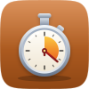
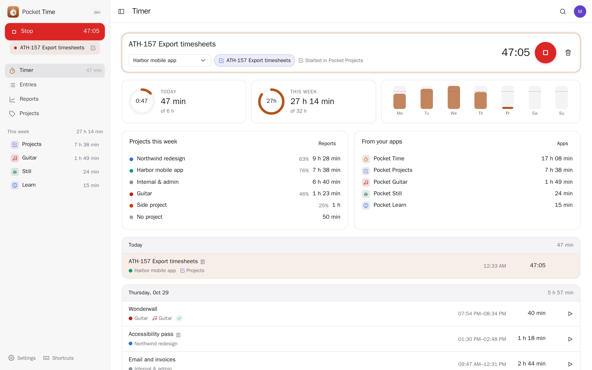
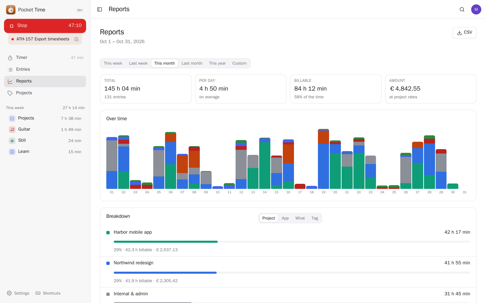
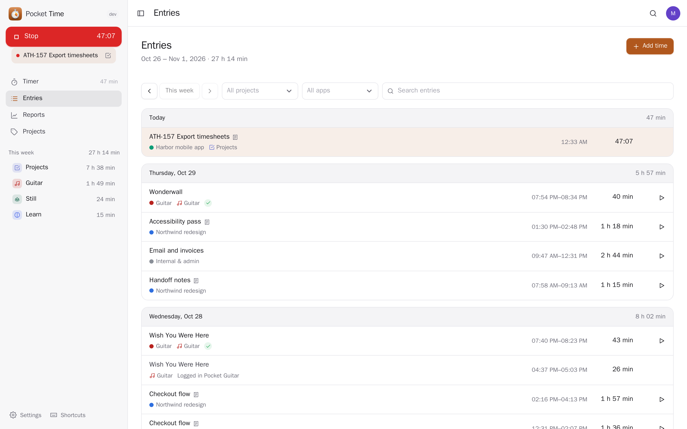
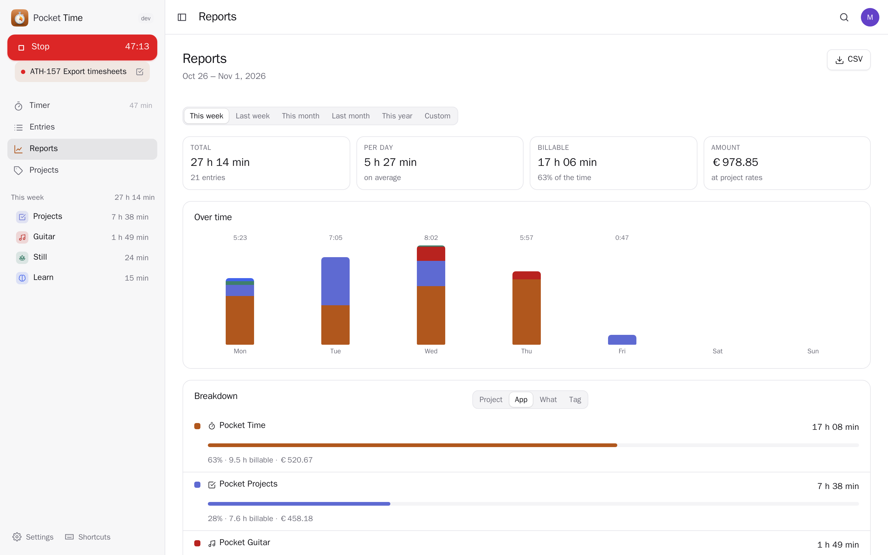
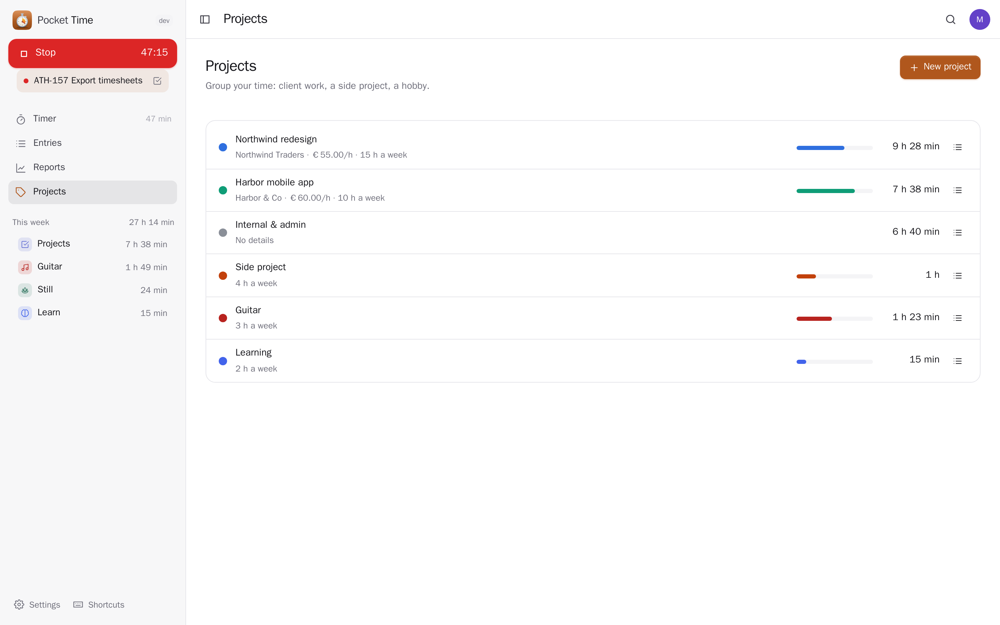
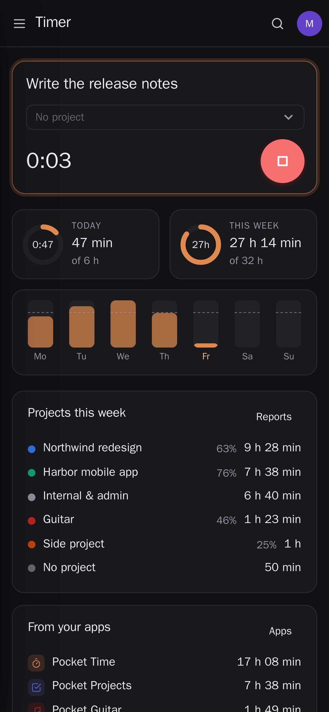
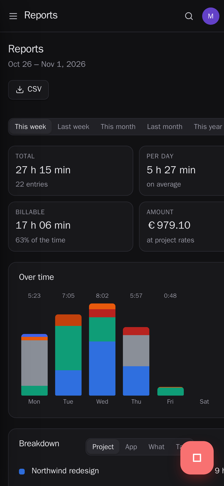

<p align="center"></p>
<h1 align="center">Pocket Time</h1>
<p align="center">One place for all your timers. Start a timer here — or in Pocket Guitar while you practise a song, on an issue in Pocket Projects, while you study in Pocket Learn — and it is the same timer everywhere: stop it from either place. The time those apps keep themselves shows up here too, so your whole week is in one list: edit entries, group them by project, see what is billable and look back at where the time went.<br>One Go binary, one SQLite file, one volume. Part of the Pocket apps; works on its own too.</p>
<p align="center">
  <a href="https://github.com/abjelosevic88/pocket-homelab-time/actions"></a>
  <a href="https://github.com/abjelosevic88/pocket-homelab-time/pkgs/container/pocket-homelab-time"></a>
  <a href="LICENSE"></a>
</p>

---

<p align="center"></p>

<table>
  <tr>
    <td width="50%"></td>
    <td width="50%"></td>
  </tr>
  <tr>
    <td align="center"><sub>Reports: any period by day, by project, app, item or tag; billable hours and the amount at your rates; CSV.</sub></td>
    <td align="center"><sub>Entries a week at a time, from here and from your apps, with what each was for.</sub></td>
  </tr>
  <tr>
    <td width="50%"></td>
    <td width="50%"></td>
  </tr>
  <tr>
    <td align="center"><sub>Where the week went, by app: issues, practice, studying and everything timed here.</sub></td>
    <td align="center"><sub>Projects with a client, an hourly rate and a weekly target.</sub></td>
  </tr>
</table>

<p align="center">
  &nbsp;&nbsp;
  
</p>

## What it does

- **One timer, everywhere**: type what you are doing and press start — or start it from another Pocket app. Only one runs at a time; starting another asks whether to stop the running one and switch (or just switches, if you prefer). Change the start time, the project or what it is for while it runs; throw it away if it was a mistake; a push after a few hours if you forgot to stop it.
- **For something in another app**: pick a song in Pocket Guitar, an issue in Pocket Projects, a deck in Pocket Learn, a meditation in Pocket Still or a client in Pocket Invoicing. When the timer stops, the time is logged there too — practice minutes on the song, time spent on the issue.
- **All your time together**: the time those apps log themselves (Guitar's song player, Still's meditation timer, time on an issue) is brought in every 15 minutes, read-only, without counting anything twice.
- **Entries**: a week at a time, grouped by day, filtered by project, app or words; add time by hand, edit, continue with one click.
- **Projects**: colour, client, billable or not, an hourly rate, a weekly target.
- **Reports**: this week, last week, a month, a year or any range, by day, stacked by project; by project, app, item or tag; billable hours and the amount; rounding (6, 15, 30 minutes…); CSV; a short AI look back with Pocket AI or your own OpenAI key.
- **Coming from Toggl, Clockify, Kimai or Harvest**: import their CSV export as it is.
- **Everyone their own**: each person has their own timer, entries, projects and connections; admins see no one else's.

## Run it

```sh
docker run -d --name pocket-time -p 8080:8080 -v ./data:/data \
  -e BASE_URL=https://time.example.com -e SECURE_COOKIES=true \
  ghcr.io/abjelosevic88/pocket-homelab-time:latest
```

or `docker compose up -d` with [docker-compose.yml](docker-compose.yml). Open it, create the first account and start a timer. All options: [docs/configuration.md](docs/configuration.md). API: [docs/api.md](docs/api.md).

## With Pocket Core

Set `CORE_URL` and `CORE_REGISTRATION_KEY` and Time joins the box: people sign in with Pocket Core, and through app links (per person, nothing to paste) the other Pocket apps share the timer (`time:write`), Pocket Day reads your tracked time (`time:read`), and Time reads and writes the time those apps keep: `guitar:read|write`, `mindfulness:read|write` (Still) and the small worklog contract `worklog:read|write` (Projects, Invoicing, Learn) — see [docs/worklog.md](docs/worklog.md) to connect another app. Events on the bus: `time.timer_started`, `time.timer_stopped`, `time.entry_logged`. Without Core each app can be connected directly with a URL and a token; the Core-only choices stay visible, greyed out.

## Develop

```sh
make dev     # API on :8080 with demo data + Vite on :5173
make test    # go vet, go test, tsc
make         # web + binary
```

MIT licensed.
